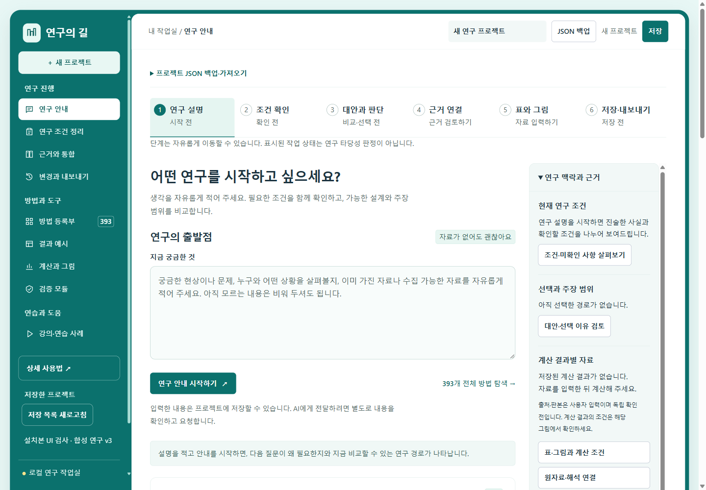

# 연구의 길 — 학생용 다운로드

[**학생용 통합 ZIP 다운로드 · 0.12.1**](https://github.com/jinmin75/research-workbench-download/releases/download/v0.12.1/research-workbench-student-0.12.1.zip)

[**상세 사용법 · 활용법 바로 읽기**](USER-GUIDE.md) · [검사 결과](RELEASE-VERIFICATION.md)

## 처음 시작하기

1. 위의 학생용 통합 ZIP 한 개를 받습니다. GitHub의 Source code 파일은 실행용이 아닙니다.
2. 마우스 오른쪽 버튼 → **모두 압축 풀기**로 새 폴더에 풉니다.
3. 폴더의 **시작.cmd**를 실행합니다. 필요한 Node.js·GPT/Codex·Claude 도구를 자동으로 준비하므로 첫 실행에는 인터넷이 필요합니다.
4. 브라우저에서 연구 설명을 적고 안내를 시작합니다. AI 없이도 안내·계산·저장·재현 ZIP을 사용할 수 있습니다.

앱·AI 연결기·자동 준비·상세 사용서가 ZIP 하나에 들어 있습니다. ZIP 안에서 바로 실행하지 마세요. 관리자 권한이나 시스템 PATH 변경은 필요하지 않습니다.

## 0.12.1에서 달라진 점

**연구 설명 → 조건 확인 → 대안과 판단 → 근거 연결 → 표와 그림 → 저장·내보내기**로 이어집니다. 설계 대안의 이유·주장 범위·부족한 조건을 같은 표에서 비교합니다. 오른쪽에서 연구 조건과 판단·출처를 확인하고, 질적 원문과 해석·반례를 나란히 검토합니다. 계산 후 입력을 접고 결과에 집중할 수 있습니다.

393개 방법 탐색과 접근별 결과 예시, AI 제안의 선택 적용, 집단 비교·반복측정·평균차와 조건부 95% 신뢰구간, 저장·변경 추적·재현 ZIP을 유지합니다. 합성 계산 예시 4개와 설명용 구성 389개를 구분합니다. 군집/가중 보정·다층/혼합모형 계산은 미지원입니다.

## AI 연결

- **GPT/Codex·Claude:** 작업실의 **AI 연결·제안 검토 열기** → 로그인 시작 → 공식 창에서 인증 → 앱으로 돌아와 연결 상태 확인 → 합성 사례로 실제 응답 시험. 본인 계정의 도구 사용 권한·한도가 적용됩니다.
- **Gemini:** Gemini API 키를 입력합니다. Gemini 구독과 API는 별도이며 사용량·비용·데이터 조건을 확인합니다.

보낼 내용을 확인하고 동의한 뒤 요청합니다. AI 응답·도구 로그인·계산 재현은 서로 다른 상태이며 연구 타당성 승인을 뜻하지 않습니다. [계정 연결과 오류 해결](USER-GUIDE.md) · [자동 준비](AUTO-SETUP.md)

## 기존 사용자의 업데이트

이전 앱에서 **JSON 백업 → Stop.cmd로 종료 → 새 ZIP을 새 폴더에 풀어 실행 → 백업 가져오기** 순서로 옮깁니다. 제목·자료·판단·그림을 확인할 때까지 이전 폴더와 백업을 보관하세요. 기존 projects 폴더를 새 프로그램 파일로 덮어쓰지 마세요.

공개 ZIP은 개별값·ID·궤적을 제외하므로 완전 재계산할 수 없습니다. 원자료 포함 ZIP은 전체 프로젝트의 텍스트 기록도 담을 수 있으므로 공유 범위를 확인합니다.

Windows x64 개발 PC에서 실제 도구 설치, 최종 ZIP 압축 해제·실행, 새 UI·저장·계산·다운로드·재현을 검사했습니다. 학생의 별도 PC·실제 계정 로그인/AI 응답·전문가 적합성·학습 효과 평가는 미실시입니다. [검사 범위와 파일 해시](RELEASE-VERIFICATION.md)

## 이용 조건

저작권자의 허락을 받은 수강생이 학습·연구 목적으로 사용하는 프로그램입니다. 자세한 내용은 [LICENSE.md](LICENSE.md)를 확인하세요. [이전 판본과 변경 기록](https://github.com/jinmin75/research-workbench-download/releases)

© 2026 이진민 (DiA AI Edu. Solution). All rights reserved.
