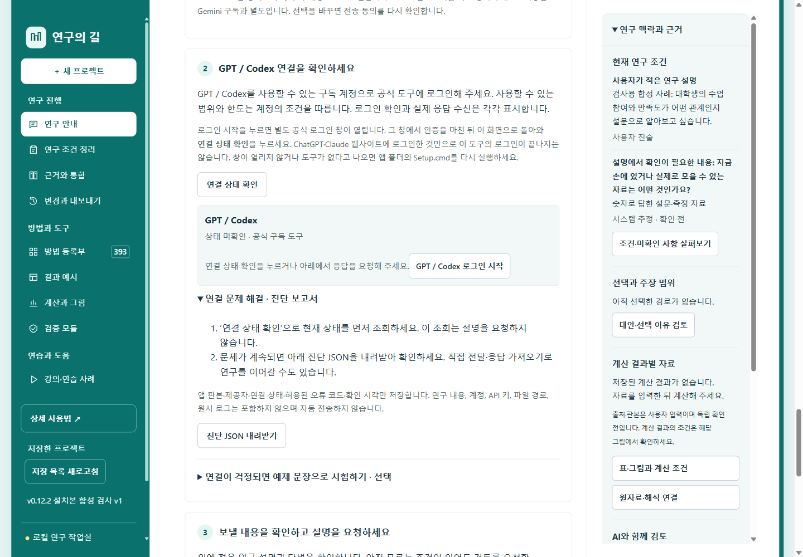

# 연구의 길 — 학생용 다운로드

[**학생용 통합 ZIP 다운로드 · 0.12.6**](https://github.com/jinmin75/research-workbench-download/releases/download/v0.12.6/research-workbench-student-0.12.6.zip)

[**상세 사용법 · 활용법 바로 읽기**](USER-GUIDE.md) · [검사 결과와 파일 해시](RELEASE-VERIFICATION.md)

주장 문구 점검과 연구 목적별 경로 분기를 손보고, 브라우저 기본 확인 창을 앱 내부 대화상자로 바꿨습니다. 계산 뒤 질적·혼합 근거만 편집할 때는 기존 수치 결과를 그대로 유지하고, 척도 이탈과 결측 점검 알림을 표시합니다. [검사 결과](RELEASE-VERIFICATION.md)

## 처음 시작하기

1. 위의 학생용 통합 ZIP 한 개를 받습니다. GitHub의 Source code 파일은 실행용이 아닙니다.
2. 마우스 오른쪽 버튼 → **모두 압축 풀기**로 새 폴더에 풉니다.
3. 폴더의 **시작.cmd**를 실행합니다. 필요한 Node.js·GPT/Codex·Claude 도구를 자동으로 준비하므로 첫 실행에는 인터넷이 필요합니다.
4. 브라우저에서 연구 설명을 적고 안내를 시작합니다. AI 없이도 안내·계산·저장·재현 ZIP을 사용할 수 있습니다.

앱·AI 연결기·자동 준비·상세 사용서가 ZIP 하나에 들어 있습니다. ZIP 안에서 바로 실행하지 마세요. 관리자 권한이나 시스템 PATH 변경은 필요하지 않습니다.

## 0.12.6에서 달라진 점

- **주장 문구 판정과 경로 분기**: '높였다·향상시켰다·개선했다·고립시킨다' 같은 인과 동사와 '학계의 합의', 성급한 일반화, 분모 없는 백분율 단정을 검출합니다. "단정할 수 없다" 같은 유보·부정문은 과잉 경고에서 제외했습니다. 이론 발전·과정 추적·문헌과 사료 비판(`records`) 같은 목적과 자료 분기가 다른 분기에 가리지 않도록 정리했고, 선택한 대안에 맞게 허용 주장 문구를 연동했습니다.
- **앱 내부 확인 대화상자와 백업**: 브라우저 기본 `window.confirm` 창 대신 앱 내부 확인 대화상자를 사용합니다. 상단 **JSON 백업** 버튼은 확인 창을 거치지 않고 곧바로 백업 파일을 내려받습니다.
- **수치 결과 보존**: 수치 계산 뒤 질적 근거, 혼합연구 공동표시, 주장 초안만 고치고 저장할 때는 기존 계산 표와 그림이 '재계산 필요'로 바뀌지 않도록 분리했습니다.
- **표시 반올림·진단 알림·AI 요약**: 기술통계와 비교 결과 표 수치는 소수 셋째 자리까지 반올림해 보여 줍니다. 척도 범위 밖 값(예: 5점 리커트에서 `9`), 단일 서열 문항 평균 주의, `n < 10` 소표본, 20% 이상 결측 시 점검 알림을 띄우고, 비교 결과에 `Welch t` 또는 `대응표본 t` 표기와 군집·가중 보정 보류를 함께 적었습니다. AI 전송 맥락에는 원자료 행을 뺀 요약 통계와 개인정보 주의 알림을 추가했습니다.

## 0.12.5에서 개선한 결과 예시와 그림

- **결과 예시**에서 그림과 읽는 법을 먼저 볼 수 있습니다. 기술통계·빈도·상관·회귀의 합성 예시는 32~36행입니다. 질적·혼합 예시에는 면담 발췌와 경쟁 설명, 양적·질적 근거를 나란히 읽는 표를 보강했습니다.
- 긴 변수명·단위·출처는 그림에서 여러 줄로 나눠 표시합니다. 좁은 화면에서는 그림 영역을 좌우로 움직일 수 있습니다.
- **계산과 그림**에서 집단 비교와 반복측정을 합성 자료로 연습할 수 있습니다. 적용 조건을 확인해 선택하면 차이와 신뢰구간을 표시합니다. **원자료 포함 비교 재현 ZIP 저장**으로 받은 ZIP을 풀고 **재현 확인.cmd**를 실행하면 같은 계산과 그림·표를 확인할 수 있습니다. [0.12.5 검사 기록](RELEASE-VERIFICATION-v0.12.5.md) · [예시와 재현 실습 사용법](USER-GUIDE.md)

## 0.12.4에서 개선한 AI 로그인

GPT/Codex와 Claude의 **로그인 시작**을 누르면 공식 창이 열립니다. **연결 상태 확인**에서는 인증 대기, 명령 실패, 창 닫힘을 확인할 수 있습니다. GPT/Codex는 OpenAI 브라우저 탭에서 인증합니다. Claude가 일회용 코드를 보여주면 공식 Claude 로그인 터미널에 입력하세요. [0.12.4 검사 기록](RELEASE-VERIFICATION-v0.12.4.md)

## 연결 상태와 오류 안내

GPT/Codex·Claude의 **연결 상태를 확인하지 못한 경우**와 **로그인이 필요한 경우**를 구별합니다. 상태를 확인하지 못하면 연구 설명을 보내지 않습니다. Gemini를 포함한 오류별 다음 조치와 **진단 JSON 내려받기**를 추가했습니다. 진단 파일은 연구 내용·계정·키·경로·원시 로그를 포함하지 않으며 자동 전송이나 AI 재요청을 하지 않습니다.

자동 준비의 PowerShell 7 호환성 문제를 보완했습니다. 기본 **시작.cmd**는 Windows PowerShell 5.1을 사용합니다. 두 환경의 정상·변조 패키지 검사를 확인했습니다.

위 화면은 격리한 합성 프로젝트의 설치본입니다. 실제 계정 인증이나 AI 응답 성공을 보여 주는 화면은 아닙니다.

## AI 연결 순서

1. 작업실의 **AI 연결·제안 검토 열기**를 누릅니다. 좁은 화면에서는 본문 아래에 있습니다.
2. **GPT/Codex·Claude**는 로그인 시작 → 공식 창에서 인증 → 앱으로 돌아와 **연결 상태 확인** 순서로 진행합니다. 본인 계정의 공식 도구 사용 권한·한도가 적용됩니다.
3. **Gemini**는 본인의 API 키를 등록합니다. Gemini 구독과 API는 별도이며 사용량·비용·데이터 조건을 확인합니다.
4. 선택 사항인 합성 연결 시험으로 실제 응답을 확인한 뒤, **보낼 내용 확인하기 → 전송 동의 → 설명 요청 → 제안 검토·선택 적용**으로 진행합니다. **대안과 판단 → 조건·근거 검토 → 판단 기록 남기기 → 상단 저장**으로 선택 이유를 보관합니다.
5. 응답이 없거나 오류가 나면 **2. 연결 확인 → 연결 문제 해결 · 진단 보고서**를 펼칩니다. 조회 실패라면 먼저 상태를 다시 확인하고, 표시된 조치에 따릅니다. 직접 전달·응답 가져오기로 이어갈 수도 있습니다.

로그인 상태·실제 응답·계산 재현·연구 타당성은 별도 상태입니다. [계정 연결과 오류 해결](USER-GUIDE.md) · [자동 준비](AUTO-SETUP.md)

## 기존 연구 기능과 업데이트

**연구 설명 → 조건 확인 → 대안과 판단 → 근거 연결 → 표와 그림 → 저장·내보내기** 흐름을 유지합니다. 393개 방법 탐색과 접근별 결과 예시, AI 제안 선택 적용, 집단 비교·반복측정·평균차와 조건부 95% 신뢰구간·히스토그램, 저장·변경 추적·재현 ZIP을 사용할 수 있습니다. 합성 계산 예시 4개와 설명용 구성 389개를 구분합니다. 전체 방법의 출처·추천·실행 검증을 완료한 제품은 아닙니다. 군집/가중 보정·다층/혼합모형 계산은 미지원입니다.

이전 앱에서 **JSON 백업 → Stop.cmd로 종료 → 새 ZIP을 새 폴더에 풀어 실행 → 백업 가져오기** 순서로 옮깁니다. 제목·자료·판단·그림을 확인할 때까지 이전 폴더와 백업을 보관하세요. 기존 projects 폴더를 새 프로그램 파일로 덮어쓰지 마세요.

공개 ZIP은 개별값·ID·궤적을 제외하므로 완전 재계산할 수 없습니다. 원자료 포함 ZIP은 전체 프로젝트의 텍스트 기록도 담을 수 있으므로 공유 범위를 확인합니다.

0.12.4 검사에서는 Windows x64의 빈 폴더에서 Node·Codex·Claude 준비를 확인했습니다. 이 PC의 시험 계정으로 공식 로그인, 실제 설명 받기, 제안 적용, 판단 기록 저장·다시 열기를 검사했습니다. [0.12.4 AI 연결 검사](RELEASE-VERIFICATION-v0.12.4.md)

## 이용 조건

저작권자의 허락을 받은 수강생이 학습·연구 목적으로 사용하는 프로그램입니다. 자세한 내용은 [LICENSE.md](LICENSE.md)를 확인하세요. [이전 판본과 변경 기록](https://github.com/jinmin75/research-workbench-download/releases)

© 2026 이진민 (DiA AI Edu. Solution). All rights reserved.
